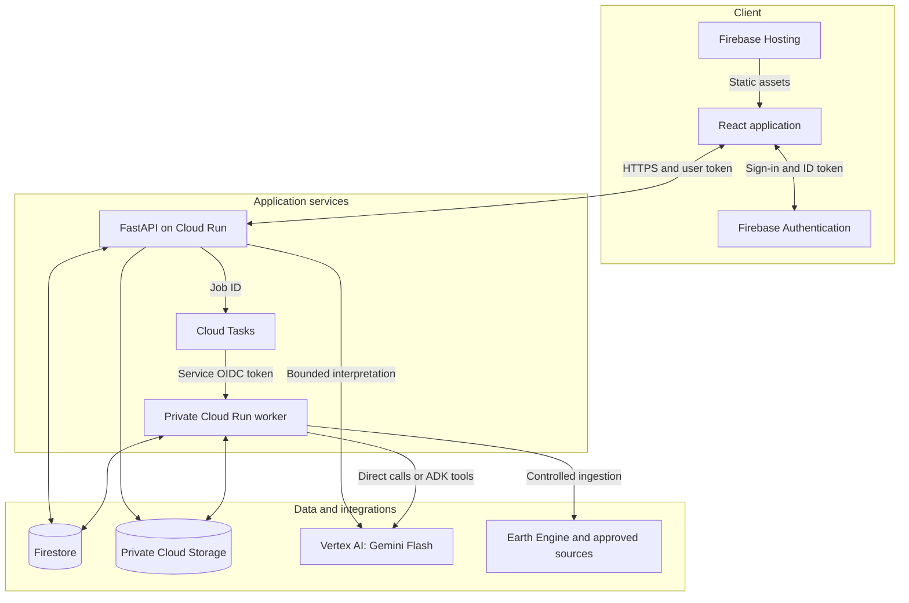
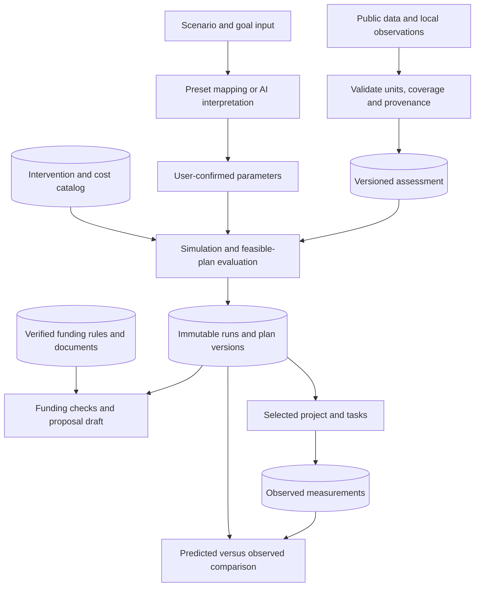
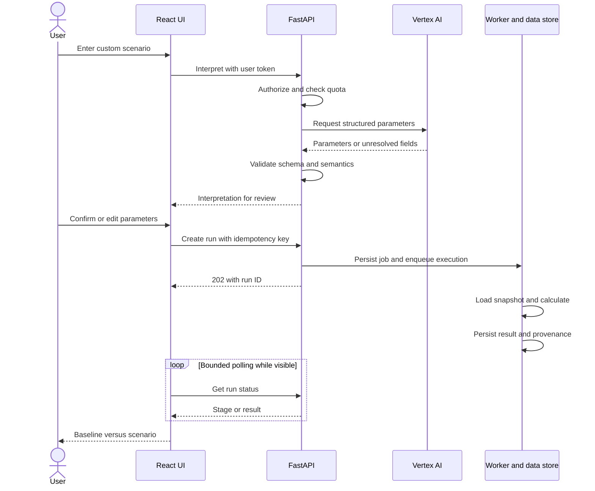
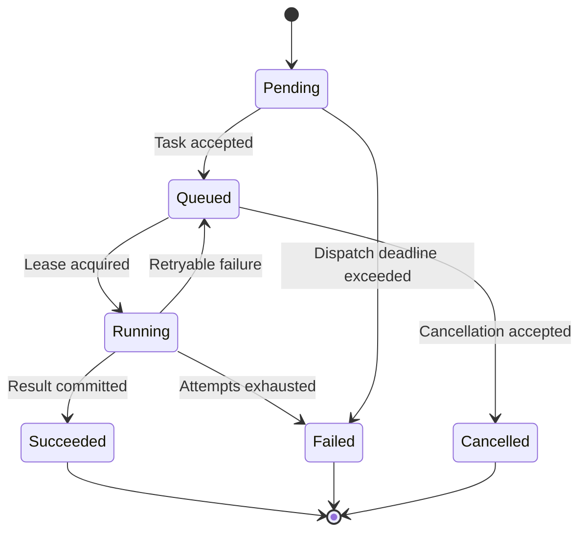

# WaterPilot — High-Level Design

Version 1.0 | 7 October 2026 | Proposed implementation baseline

This HLD consolidates the latest decisions: Firebase Hosting, Firebase Authentication, FastAPI on Cloud Run, Firestore for the budget-constrained pilot, and Gemini Flash through Vertex AI. These decisions supersede the older blueprint's frontend container, Cloud SQL/PostGIS, load balancer and Cloud Armor baseline. That blueprint remains historical design context. No infrastructure has been deployed by this document.

The target is a controlled, one-area pilot with all agreed product flows. The financial target is ₹0 out of pocket while eligible credits and service allowances cover usage; live Vertex AI is metered. This is not an unlimited-free or zero-defect production guarantee. Model availability, region, eligibility and credits must be checked in the actual project before provisioning.

## 1. Product scope

| Screen/reference             | Capability                                                             | Owning modules                        |
| ---------------------------- | ---------------------------------------------------------------------- | ------------------------------------- |
| Understand Your Area / 3.png | Area selection, water profile, reliability, demand, deficit, map       | Areas, assessments, data catalog      |
| Water Source Details / 8.png | Contributions, data sources, assumptions, export                       | Assessments, provenance               |
| What if / 4.png              | Suggested prompts, controls, custom scenario, confirmation, simulation | Scenarios, interpretation, simulation |
| Set Goal / 5.png             | Targets, budget, deadline, priority, custom input                      | Goals, planning                       |
| Compare Plans / 6.png        | Feasible alternatives, costs, benefits, neighbour impact               | Planning, economics, impact           |
| Make It Happen / 1.png       | Five detail accordions and funding drawer                              | Plans, funding, implementation        |
| Generate Proposal / 2.png    | Section selection, draft, progress, PDF review/download                | Reports, bounded AI workflow          |
| Execute and Track / 7.png    | Milestones, tasks, measurements, forecast versus actual                | Projects, observations                |

Show up to three useful alternatives, not three fabricated plans when only one is feasible. Explain infeasible goals and missing data. Environmental, water-quality and neighbour-impact conclusions require adequate evidence; missing measurements cannot become invented scores. Example screenshot numbers are not scientific requirements.

## 2. Architecture approach

Use a modular monolith: one backend codebase with explicit domain boundaries, deployed as an API and a private worker. Separate deployment permits worker scaling without splitting every feature into a microservice. Pure domain functions contain water and economic calculations; adapters contain Firebase, Vertex AI, Earth Engine and storage integration.

Arrows describe logical calls/data access, not public network exposure. Cloud Logging/Monitoring, IAM, Artifact Registry and Cloud Build support these services but are omitted from the diagram for readability.

Use the provided Hosting domain and Cloud Run API URL initially. Configure exact allowed frontend origins in CORS. Public API invocation reaches an application authentication boundary; it does not give anonymous access to user data. Worker invocation is IAM-restricted. Do not confuse Firebase user tokens with Google service-to-service OIDC tokens.

No load balancer, Cloud Armor, Kubernetes, Redis, paid search index or always-on database in the pilot baseline. This leaves weaker edge-level abuse protection; controlled access, application quotas and scale limits reduce but cannot eliminate cost exposure.

## 3. Component responsibilities

| Component                     | Responsibility and boundary                                                                              |
| ----------------------------- | -------------------------------------------------------------------------------------------------------- |
| React + TypeScript + Vite     | Route-based feature modules, accessible components, themes, interaction and presentation                 |
| SCSS Modules + CSS variables  | Light/dark palettes, spacing and typography tokens; CSS/SVG animations with reduced-motion support       |
| Axios + TanStack Query        | One authenticated API client, typed contracts, cancellation, caching, invalidation and bounded polling   |
| Firebase Auth modular SDK     | Google/email sign-in, reset/verification, token lifecycle and configured persistence                     |
| FastAPI + Pydantic            | Authentication, authorization, schema validation, commands and query endpoints                           |
| Deterministic domain engine   | Water balance, intervention constraints, cost/return calculations and reproducible ranking               |
| Firestore                     | Tenant membership, immutable assessment/plan revisions, jobs, projects and compact audit records         |
| Cloud Storage                 | Raw datasets, geographic files, original funding documents and generated PDFs                            |
| Cloud Tasks + worker          | Durable deferred execution, retry control, proposal generation and ingestion                             |
| Vertex AI + Google Gen AI SDK | Structured language interpretation and grounded explanations/drafting                                    |
| ADK inside worker             | Bounded orchestration of approved funding/proposal tools; no separate agent platform deployment required |
| Earth Engine adapter          | Approved environmental preprocessing; dashboard reads saved assessments                                  |

Use supported, compatible stable package versions selected during repository setup, pinned with lockfiles. Exact Gemini model ID is configuration, selected after checking supported structured output, region and pricing. Do not use an unverified preview model by default.

## 4. Frontend design

Feature boundaries: area, scenarios, goals, plans, funding, proposals and tracking. Shared components include AppShell, MetricCard, ComparisonChart, SourceBadge, AssumptionPanel, SuggestionChips, Accordion, Dialog, Drawer and JobProgress. Shared components own presentation; feature hooks own data coordination.

Theme state and authenticated-user state use small contexts. Remote state belongs in TanStack Query. Navigation state belongs in the URL where safe and useful; sensitive input does not. Use native Intl formatting for locale-aware numbers, dates, percentages and INR. Simple charts use SVG with accessible table alternatives. Start with a bounded GeoJSON/SVG map; only add a tile provider after checking licence, attribution and usage costs.

Animations use transforms/opacity, respect prefers-reduced-motion and stop when hidden. A water-flow scroll effect remains decorative. Loading states show actual job stages rather than fabricated progress percentages. Lazy-load map/report code and routes; keep current data visible during refresh.

Suggestion clicks fill editable inputs and map directly to known parameter schemas. Examples: tanker supply stops for 30 days; rainfall falls 20%; demand rises 15%. Goal examples: reduce tanker dependence 30% in 12 months; fewer than 15 shortage days per year; maximize savings within ₹10 lakh. Only show supported scenarios. Confirm dates, scope, units and relative versus absolute percentage changes before execution.

## 5. Domain and data flow

The simulation uses explicit timestep, geography, start date, units and baseline. For example, a tanker interruption changes the tanker contribution over a defined interval; it does not automatically set all water supply to zero. Rainfall impacts need calibrated response assumptions. Storage carry-over, demand, supply, reuse and losses must not be double-counted.

Define reliability and shortage-day metrics before implementation. A shortage count and the time until a shortage are different metrics. Scenario versions never silently mutate existing results. Calibration candidates require review before becoming new model releases.

## 6. AI boundary

| AI task                  | Allowed output                                  | Validation                                                       |
| ------------------------ | ----------------------------------------------- | ---------------------------------------------------------------- |
| Interpret custom What-if | Typed scenario parameters and unresolved fields | Schema, supported operation, units, bounds, user confirmation    |
| Interpret custom goal    | Target, horizon, budget, priority and scope     | Completeness and feasibility evaluated outside the model         |
| Explain results          | Narrative based on supplied run results         | Numeric references must match the run                            |
| Funding assistance       | Candidates and citations from approved catalog  | Rule-based eligibility checks; uncertain cases marked for review |
| Proposal drafting        | Section prose with source references            | Required sections, source existence and numeric consistency      |

ADK may call retrieve-approved-schemes, check-eligibility, read-plan-results and draft-sections. Restrict tool scope, call count, runtime and token budget. It cannot submit applications, change approved plans, run arbitrary code or browse arbitrary URLs. Retrieved documents are untrusted content, not instructions. A user reviews the draft before download/use.

Start with curated scheme metadata, indexed filters and selected document excerpts; no vector database is required. A scheme being similar to a project does not establish eligibility. If retrieval quality later demands semantic search, choose and cost it separately.

## 7. UML sequence: custom scenario

Cloud Tasks sits between API and worker as shown in the deployment diagram. Presets skip interpretation. If Vertex AI is unavailable, custom language interpretation reports failure and offers structured input; it does not return a fake interpretation. Deterministic runs can proceed from confirmed valid parameters.

## 8. Persistence model

| Record                       | Main fields and relationships                                                                 |
| ---------------------------- | --------------------------------------------------------------------------------------------- |
| Organization / membership    | orgId, uid, role, status                                                                      |
| Area / dataset snapshot      | geometry reference, coverage, source manifest, licence, observation dates, ingestion date     |
| Assessment                   | snapshotId, metricDefinitionVersion, calculated metrics, quality flags                        |
| Scenario / goal revision     | orgId, areaId, parameters, author, revision, confirmation                                     |
| Simulation run               | immutable inputs, engineVersion, inputHash, status, results, assumptions                      |
| Plan version                 | runId, interventions, cost basis, feasibility, neighbour-impact evidence                      |
| Funding scheme / match       | source version, validity dates, eligibility rules, match evidence                             |
| Proposal                     | planVersionId, templateVersion, source manifest, model ID, draft status, PDF object reference |
| Project / task / observation | selected plan version, assignees, milestones, dated measurements, units, evidence             |
| Job / audit event            | tenant, operation, attempts, lease, actor, timestamps, state transitions                      |

Organization-owned records live under organization paths or include an enforced orgId. Derive tenant context from verified membership, not an untrusted request field. Global public datasets are stored separately. Use paginated, indexed reads; avoid dashboard collection scans and unbounded listeners. Store large arrays, raster data and PDFs in objects, not database documents.

Firestore is chosen for pilot cost, not because it reproduces relational or PostGIS capabilities. Geographic processing happens offline/in workers and serves precomputed bounded results. Model denormalization and consistency explicitly. Repository interfaces ease a future migration but do not make a PostgreSQL migration automatic.

## 9. API surface

All tenant resources require authentication and authorization. Representative versioned API:

| Operation                    | Route                                                     |
| ---------------------------- | --------------------------------------------------------- |
| Identity and memberships     | GET /v1/me                                                |
| Supported areas and baseline | GET /v1/areas; GET /v1/areas/{id}/assessment              |
| Interpret scenario or goal   | POST /v1/interpretations                                  |
| Save revisions               | POST /v1/scenarios; POST /v1/goals                        |
| Execute scenario             | POST /v1/runs; GET /v1/runs/{id}                          |
| Generate and compare plans   | POST /v1/plan-generations; GET /v1/plans/{id}             |
| Funding matches              | GET /v1/plans/{id}/funding-matches                        |
| Create proposal              | POST /v1/proposals; GET /v1/proposals/{id}                |
| Track implementation         | POST /v1/projects; PATCH /v1/projects/{id}/tasks/{taskId} |
| Record measurements          | POST /v1/projects/{id}/observations                       |
| Async progress               | GET /v1/jobs/{id}                                         |

Use OpenAPI-generated frontend types. Errors carry code, safe message, field errors and requestId. Creation commands accept idempotency keys; edits use revision checks to prevent lost updates. Long operations return 202 and an authorized status URL. Never blindly retry non-idempotent writes.

## 10. Job durability and failures

Create the job plus pending-dispatch marker in one Firestore transaction. Enqueue a task identified by job ID. A scheduled reconciliation command recovers markers left pending when enqueue fails or the API crashes; use Cloud Scheduler only after accounting for its allowance. Workers acquire a transaction-protected lease and deduplicate completed jobs. Expired leases permit safe retry. Cap attempts and expose terminal failures for operator recovery.

Queue delivery may be repeated. Idempotent domain effects are mandatory; task naming alone is insufficient. Do not run essential work in an in-process background task after sending an HTTP response. Complete processing within the task deadline or checkpoint/split it; reserve Cloud Run Jobs for genuinely long batches.

## 11. Security and data provenance

- Firebase SDK manages user sessions. Axios obtains current ID tokens; FastAPI verifies signature, issuer, audience and expiry and checks membership/role/resource access. Sensitive actions also require current account status as appropriate.
- Frontend guards are UX only. Firestore client access is denied by default because browser data access goes through the API. Server SDK access uses IAM and bypasses Firestore Security Rules, so backend tenant enforcement is essential.
- Worker accepts only the queue service identity. API, worker, ingestion and build use least-privilege service accounts and application-default credentials. No service-account keys or Vertex credentials in browser code.
- Store files privately; authorize downloads and use short-lived signed URLs where appropriate. Validate file type/size and do not trust uploaded filenames or content.
- Record source title, publisher, URL, licence, temporal/spatial coverage, observation timestamp, quality status and transformation version. Every computed result retains its input snapshot and engine version.
- Candidate data: Earth Engine rainfall/surface-water/land-cover collections, official groundwater and local utility measurements. Catalog inclusion alone does not guarantee local suitability, licensing rights or water-quality coverage.
- Initial geography is a supported pilot area. Do not expose unsupported places as if calibrated water predictions exist.

## 12. Delivery and operations

One repository: frontend, backend domain/API/worker entry points, contracts, infrastructure and tests. Each module exposes a narrow interface; dependencies point from infrastructure into application/domain boundaries. Share rules, not one giant utility module. Apply SOLID where it clarifies dependencies; avoid factories/interfaces for every simple function.

Cloud Build runs checks. Frontend build deploys through Firebase CLI with preview/release handling; backend images go to Artifact Registry and Cloud Run with revision rollback. Do not imply Cloud Deploy natively deploys Firebase Hosting. Terraform tracks infrastructure where supported. Use local emulators for development and separate pilot/test resources to avoid real-data mutation.

Release gates: tenant-isolation tests; deterministic conservation/unit/invariant tests; golden calculations reviewed for the pilot; API/Firestore transaction integration; duplicate-job recovery; AI schema and prompt-injection evaluations; complete UI journey tests; accessibility and responsive checks. Target p95 cached baseline API response below 1 second under the agreed small pilot load, measured separately from cold starts. Set job and AI latency targets after representative benchmarking. These are targets, not measured guarantees.

Correlate requestId, jobId and runId. Monitor error rate, latency, queue age, failed jobs, dataset freshness, AI validation failures and service usage. Avoid logging tokens or full sensitive prompts. Limit log retention and artifact versions. Establish backup/export and restore rehearsal for records that cannot be reconstructed; cost and schedule these explicitly before real operational use.

## 13. Cost and scale boundary

Initial sizing for measurement, not a free-tier promise: one area, 10 invited evaluators, 5 concurrent sessions, and a small versioned dataset. Replace the older blueprint's larger load assumptions for this pilot. Choose colocated service regions after checking model/data availability, residency needs and region-specific allowances; do not assume an India region has identical free transfer/storage terms to US regions.

Set API/worker minimum instances to zero, bounded maximum instances/concurrency, per-user and app-wide request budgets, maximum model output and retries, queue dispatch limits and a costly-operation kill switch. Cache only with tenant-safe keys including input, snapshot, engine and prompt/model versions. Reuse valid immutable runs; never mix private results across tenants. Presets require no interpretation call. On AI quota exhaustion preserve structured input and saved results.

Vertex AI is metered; credits may temporarily offset charges. Earth Engine noncommercial access requires eligibility and quotas. Builds, artifact storage, object storage, downloads, logs, scheduling and backups can incur charges even when API request count is low. Budget alerts and maximum-instance settings are not hard spending caps. Decide whether to pause costly features or fund continued use before credits expire. Do not promise uninterrupted live AI and permanent zero cost simultaneously.

Scale when measured: raise tested service limits, optimize reads and precomputation, separate ingestion from report workers, add larger analytical stores only when necessary, and evaluate relational/spatial storage if query complexity demands it. Public rollout additionally needs an abuse/edge-security review and funded recovery objectives.

## 14. Cursor implementation order

1. Metric dictionary, source manifest and one-area sample dataset; resolve screenshot inconsistencies.
2. Repository, locked dependencies, theme tokens, shared components, API contracts and local emulators.
3. Authentication, organization isolation and baseline assessment vertical slice.
4. Deterministic scenario engine and typed goals; preset suggestion UX.
5. Vertex interpretation adapter with schema/semantic checks and confirmation.
6. Feasible-plan generation, economics and supported neighbour-impact assessment.
7. Curated funding rules, bounded ADK workflow and proposal generation.
8. Tracking, measurements, job recovery, audits, end-to-end verification and controlled deployment.

Each slice includes loading/error/empty states and meaningful tests. Do not scaffold all screens with invented production metrics and label the system complete.

## 15. Official references

- Firebase Hosting: https://firebase.google.com/docs/hosting
- Firebase authentication and backend verification: https://firebase.google.com/docs/auth/admin/verify-id-tokens
- Firestore rules and server access boundary: https://firebase.google.com/docs/firestore/security/rules-conditions
- Cloud Tasks with private Cloud Run: https://cloud.google.com/run/docs/triggering/using-tasks
- ADK on Cloud Run: https://google.github.io/adk-docs/deploy/cloud-run/
- Vertex structured output: https://cloud.google.com/vertex-ai/generative-ai/docs/multimodal/control-generated-output
- Vertex pricing: https://cloud.google.com/vertex-ai/generative-ai/pricing
- GCP free allowances: https://docs.cloud.google.com/free/docs/free-cloud-features
- Budget alerts: https://docs.cloud.google.com/billing/docs/how-to/budgets
- Earth Engine noncommercial tiers: https://developers.google.com/earth-engine/guides/noncommercial_tiers

Product documentation may redirect or change branding. Verify exact APIs, quotas and model lifecycle at implementation time.
